# Neovim Config (Minimal)

A flat Neovim setup for Python/Django: LSP, debugging, search, an HTTP client
and a database UI. Debugging also covers Go, Node, TypeScript and React.


**[Install](#install)** · **[Leader map](#leader-map)** · **[Tour](#tour)** ·
**[Workflows](#workflows)** · **[All keys](#all-keys)** · **[Debugging](#debugging)** ·
**[Development](docs/DEVELOPMENT.md)**

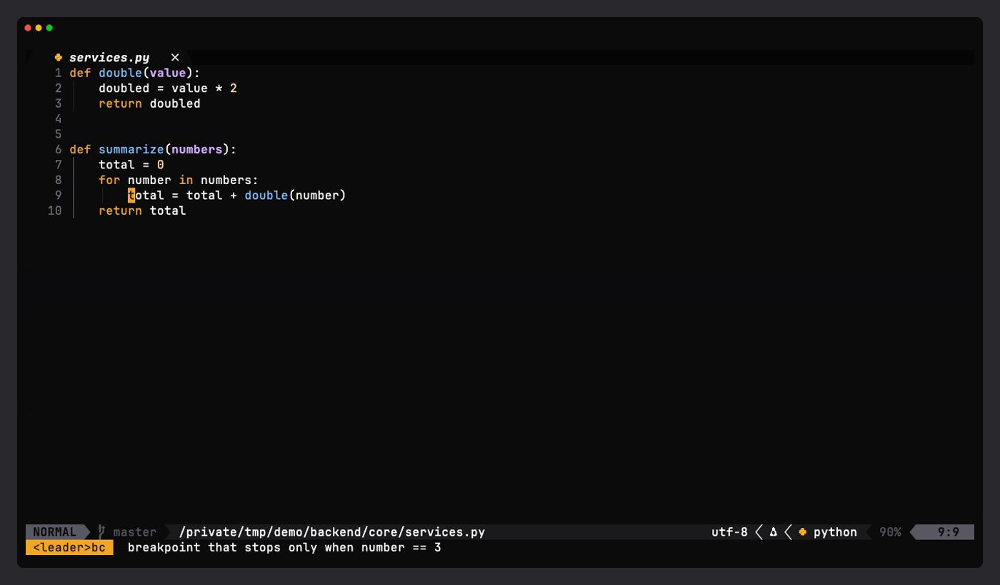

## Install

```bash
curl -fsSL https://raw.githubusercontent.com/iklobato/iklobato-nvim-config-python/main/scripts/install.sh | bash
```

Works on macOS and Ubuntu/Debian. Anything it replaces (`~/.config/nvim`,
`~/.zshrc`, lazygit config) is moved to a `.bak_<date>` copy first. Then set
your terminal font to **MesloLGS Nerd Font** so the icons show.

<details>
<summary>From a local checkout, flags, and what it installs</summary>

```bash
git clone https://github.com/iklobato/iklobato-nvim-config-python.git ~/.config/nvim
~/.config/nvim/scripts/install.sh
```

Pass `--no-dotfiles` to install Neovim only and leave `~/.zshrc` and lazygit
untouched.

- **Dependencies**: Neovim 0.12+, git, Node 22+, ripgrep, python3, git-delta
  (lazygit pager), Meslo LG Nerd Font
- **Config**: this repo at `~/.config/nvim`
- **Dotfiles**: `system/zshrc` → `~/.zshrc` and `system/lazygit.yml` → the
  platform lazygit path, plus oh-my-zsh and the zsh-syntax-highlighting plugin
  the zshrc expects
- **Plugins**: `Lazy! sync` headless, then mason installs pyright, ruff, lua_ls,
  ts_ls, stylua, prettier, debugpy, delve and js-debug-adapter. The other
  language servers the config enables (yamlls, jsonls, bashls, dockerls,
  terraformls, tflint, clangd, html, cssls, tailwindcss, eslint, marksman) are
  not installed by the script: add them with `:MasonInstall` when you need them

`system/Brewfile` is *not* installed by the script: it's a full machine dump.
Use `./scripts/brew-import.sh` if you want it.

**Requirements**

- macOS or Ubuntu/Debian (other systems: install deps manually, then run the script)
- Neovim 0.12+ (nvim-treesitter main branch), tree-sitter CLI 0.26.1+, a C compiler
- Python 3 (for LSP and DAP)
- Node.js 22.18+ and ripgrep (for Telescope, LSP servers, and the
  node/typescript debugger)
- Go (only to debug Go: mason builds delve with the local toolchain)
- tmux (for tests/e2e.sh and tests/e2e-deep.sh; e2e-deep also needs npm, curl,
  go and a Chrome for its react phase)

</details>

## Leader map

Leader is <kbd>Space</kbd>. Press <kbd>Space</kbd>, the group letter, then the action:
<kbd>Space</kbd> <kbd>t</kbd> <kbd>n</kbd> is the next tab.

<table>
<tr>
<td width="33%" valign="top">

<kbd>t</kbd> <b>tabs</b><br>
<kbd>n</kbd> next · <kbd>p</kbd> previous<br>
<kbd>o</kbd> new · <kbd>d</kbd> close

</td>
<td width="33%" valign="top">

<kbd>s</kbd> <b>splits</b><br>
<kbd>v</kbd> vertical · <kbd>h</kbd> horizontal<br>
<kbd>m</kbd> maximize · <kbd>e</kbd> equalize

</td>
<td width="33%" valign="top">

<kbd>e</kbd> <b>explorer</b><br>
<kbd>e</kbd> on / off<br>
<kbd>f</kbd> show this file

</td>
</tr>
<tr>
<td width="33%" valign="top">

<kbd>f</kbd> <b>find</b><br>
<kbd>f</kbd> files · <kbd>g</kbd> grep<br>
<kbd>o</kbd> symbols · <kbd>b</kbd> buffers

</td>
<td width="33%" valign="top">

<kbd>g</kbd> <b>go to</b><br>
<kbd>d</kbd> definition · <kbd>r</kbd> references<br>
<kbd>n</kbd> next problem · <kbd>p</kbd> previous<br>
<kbd>f</kbd> show problem · <kbd>b</kbd> git blame

</td>
<td width="33%" valign="top">

<b>save and quit</b><br>
<kbd>w</kbd><kbd>w</kbd> save<br>
<kbd>w</kbd><kbd>q</kbd> save and quit<br>
<kbd>q</kbd><kbd>q</kbd> quit, no save

</td>
</tr>
<tr>
<td width="33%" valign="top">

<kbd>b</kbd> <b>breakpoints</b><br>
<kbd>b</kbd> toggle · <kbd>c</kbd> condition<br>
<kbd>l</kbd> logpoint · <kbd>a</kbd> list<br>
<kbd>r</kbd> clear all

</td>
<td width="33%" valign="top">

<kbd>d</kbd> <b>debug</b><br>
<kbd>c</kbd> start / continue<br>
<kbd>j</kbd> over · <kbd>k</kbd> into · <kbd>o</kbd> out<br>
<kbd>t</kbd> stop · <kbd>u</kbd> UI · <kbd>f</kbd> this test<br>
<kbd>b</kbd> database UI

</td>
<td width="33%" valign="top">

<b>single keys</b><br>
<kbd>F</kbd> format<br>
<kbd>S</kbd> replace word<br>
<kbd>r</kbd><kbd>r</kbd> run HTTP request<br>
<kbd>m</kbd><kbd>p</kbd> markdown preview

</td>
</tr>
</table>

## Tour

<table>
<tr>
<td width="50%" valign="top">

**Explorer and tabs**

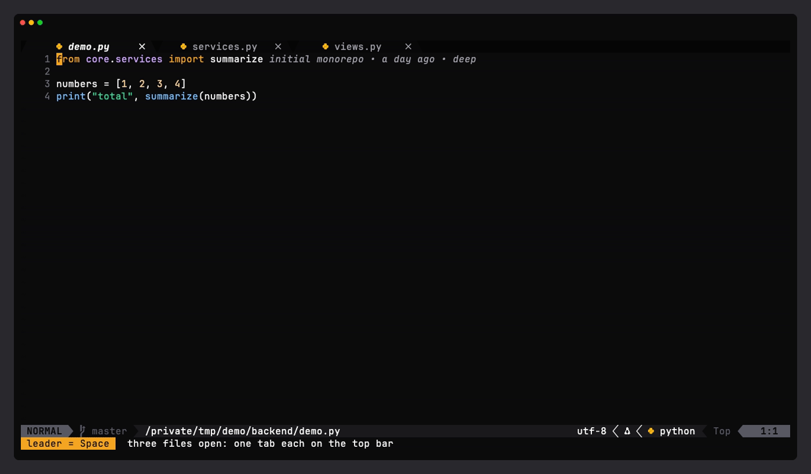

`<leader>ee` tree · `<leader>tn` `<leader>tp` next / previous tab

</td>
<td width="50%" valign="top">

**Splits**

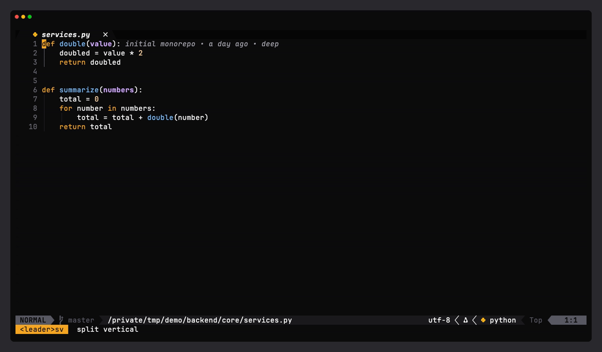

`<leader>sv` `<leader>sh` split · `<leader>sm` maximize · `<leader>se` equalize

</td>
</tr>
<tr>
<td width="50%" valign="top">

**Search**

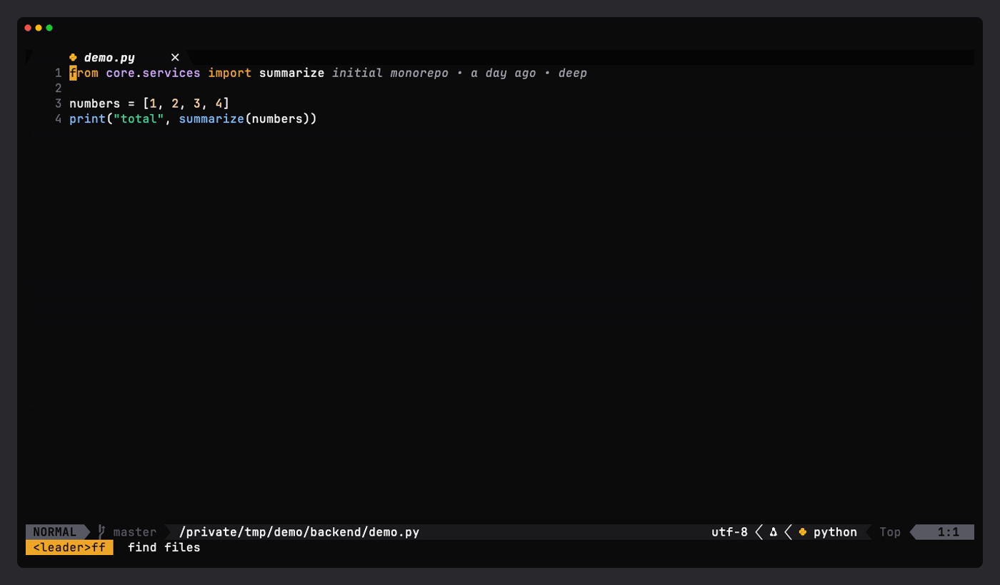

`<leader>ff` files · `<leader>fg` grep · `<leader>fo` symbols

</td>
<td width="50%" valign="top">

**LSP**

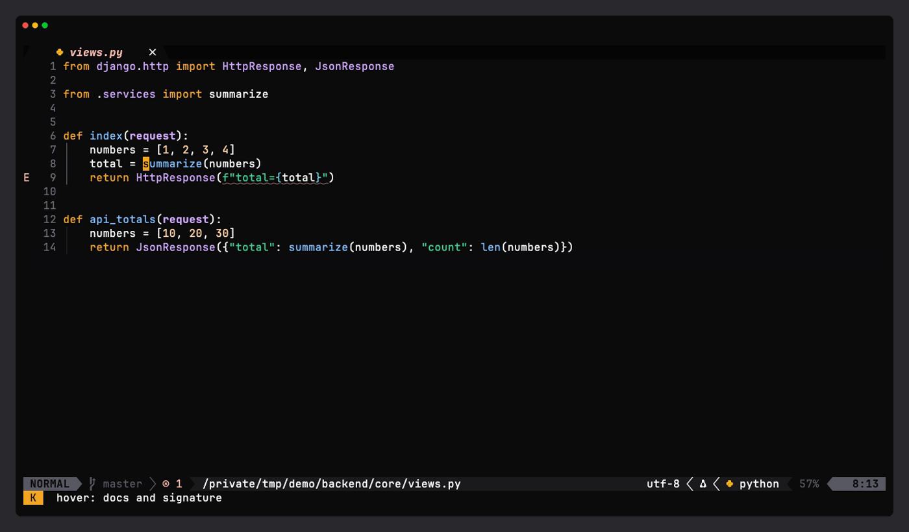

`K` hover · `<leader>gd` definition · `<leader>gr` references · `<leader>rn` rename

</td>
</tr>
<tr>
<td width="50%" valign="top">

**Diagnostics and editing**

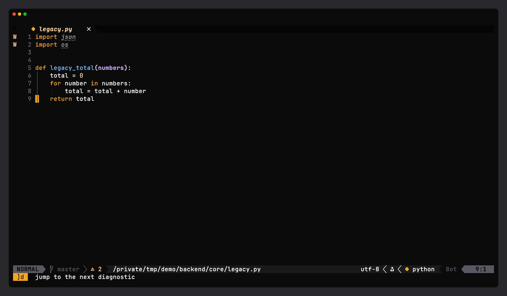

`]d` next problem · `<leader>F` format · `<leader>S` replace word

</td>
<td width="50%" valign="top">

**Debug a pytest test**

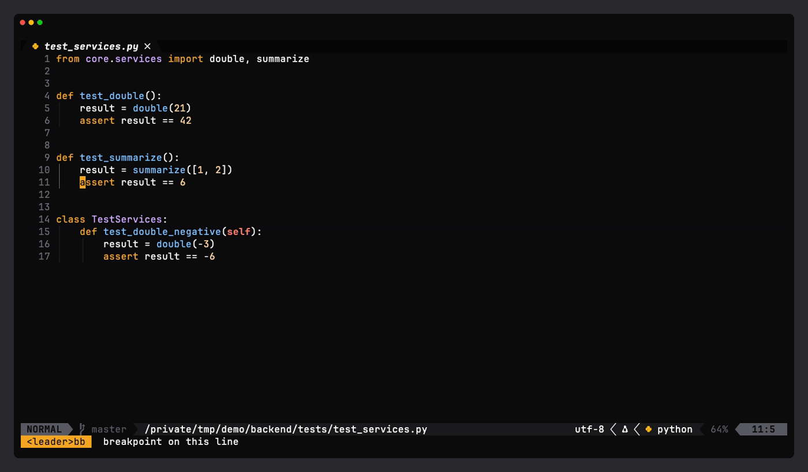

`<leader>bb` breakpoint · `<leader>df` debug this test · `<leader>dp` pick a test

</td>
</tr>
<tr>
<td width="50%" valign="top">

**HTTP client**

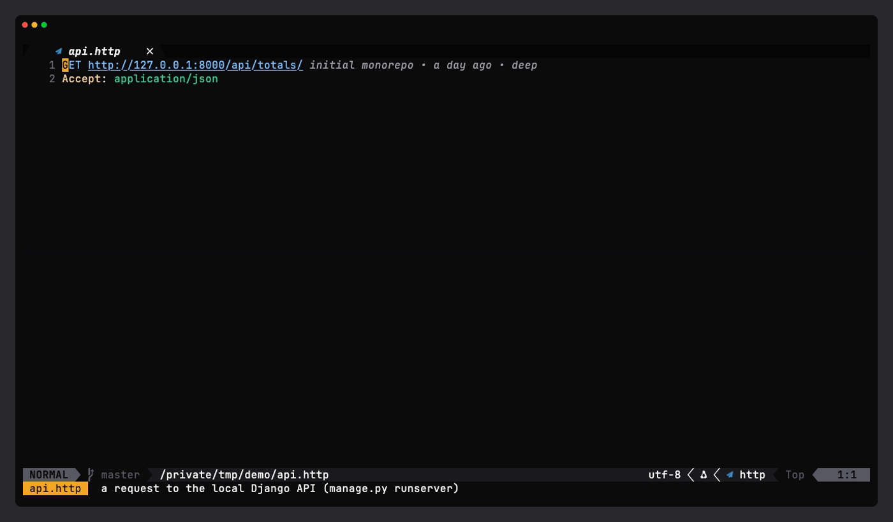

`<leader>rr` run the request under the cursor (`.http` files)

</td>
<td width="50%" valign="top">

**Database UI**

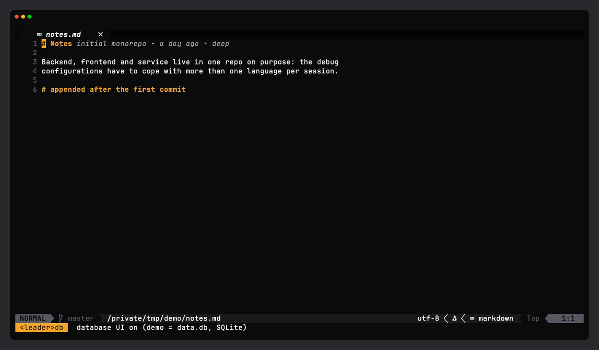

`<leader>db` open · `<leader>S` run the query in its buffer

</td>
</tr>
</table>

## Workflows

Whole tasks, start to finish.

**Debug a live API request.** Breakpoint in the Django view, start the server
under the debugger, send the request from `api.http`: it stops in the view with
the values on the left, and the response shows up after `<leader>dc`.

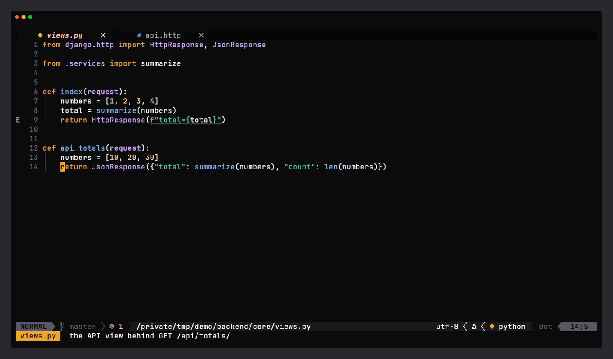

**Fix a failing test.** Debug the test, read the wrong value in Locals, jump to
the bug with `gd`, fix it, and `<leader>dl` runs the same test again.

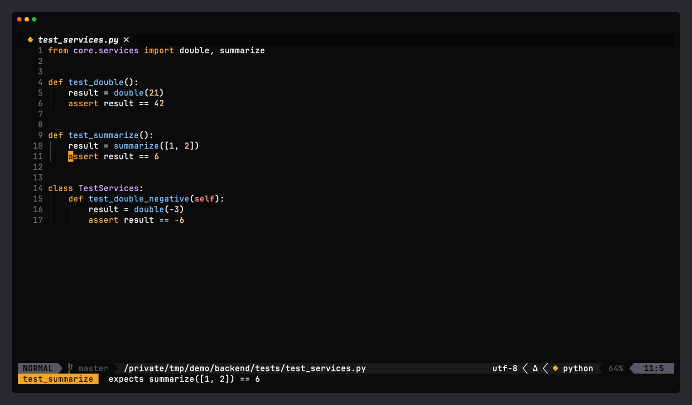

**Catch an error lost in an asyncio task.** A task nobody awaits raises, and
Python only logs it, so a normal debug run never stops. `<leader>be`, pick `2`,
then `<leader>dc`: it stops on the `raise` with the task's values in Locals.

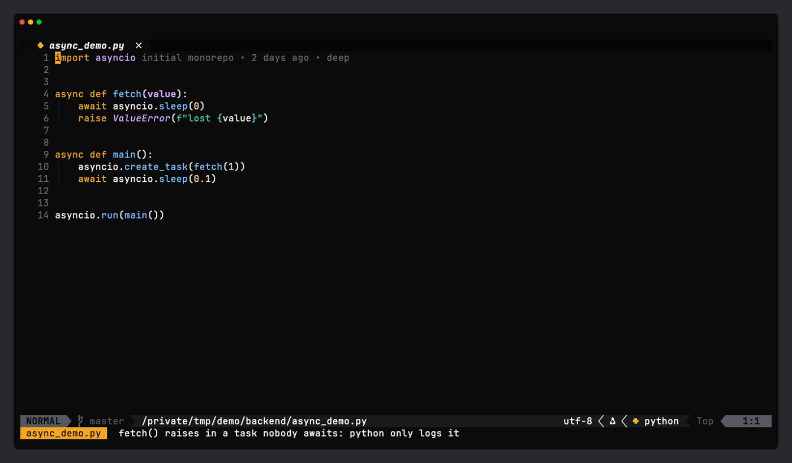

**Write code.**

<table>
<tr>
<td width="50%" valign="top">

**Completion**

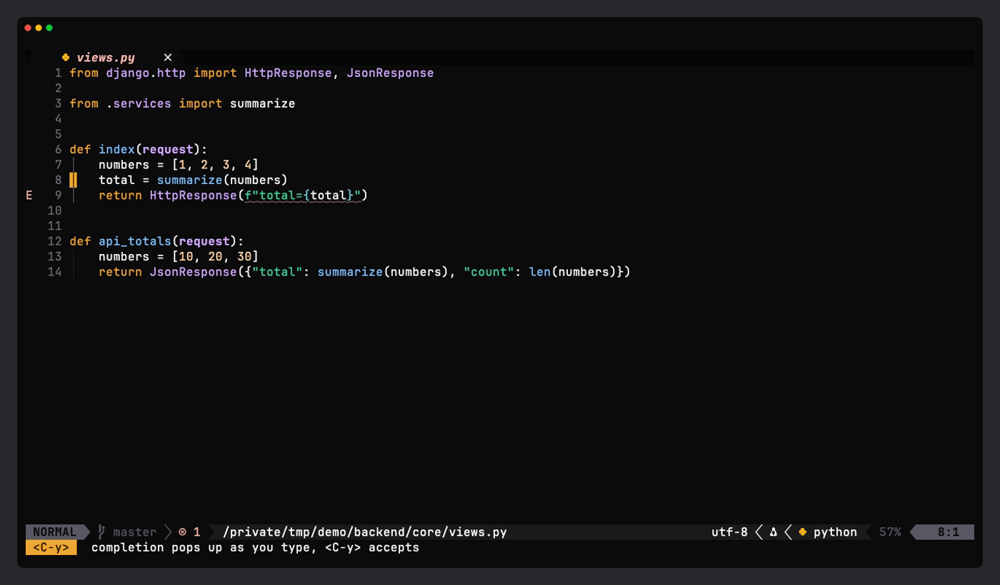

pops up as you type · `<C-y>` accepts

</td>
<td width="50%" valign="top">

**Edit by syntax**

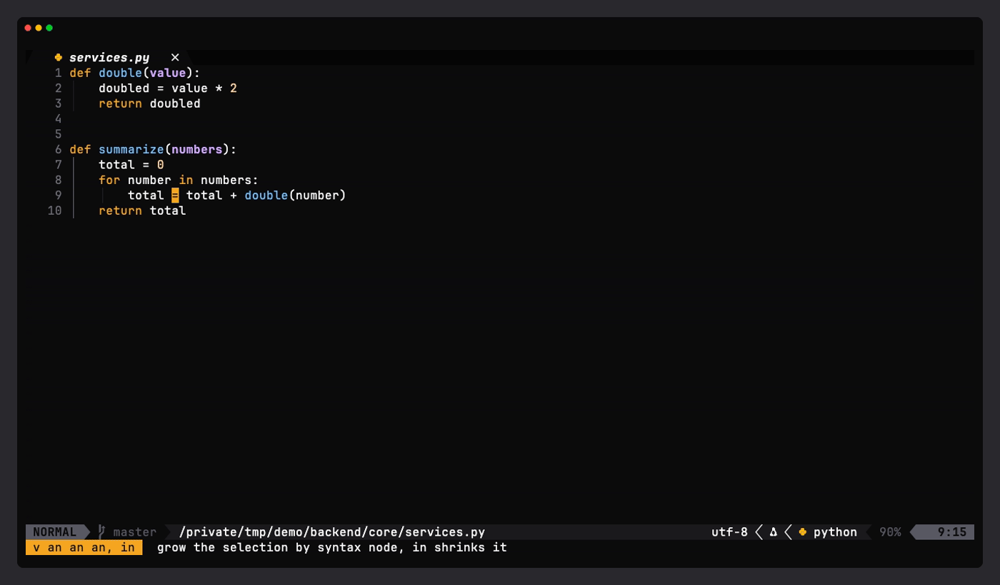

`v an an` grows · `daf` deletes a function · `{` makes an f-string

</td>
</tr>
<tr>
<td colspan="2" align="center">

**Git in the editor**

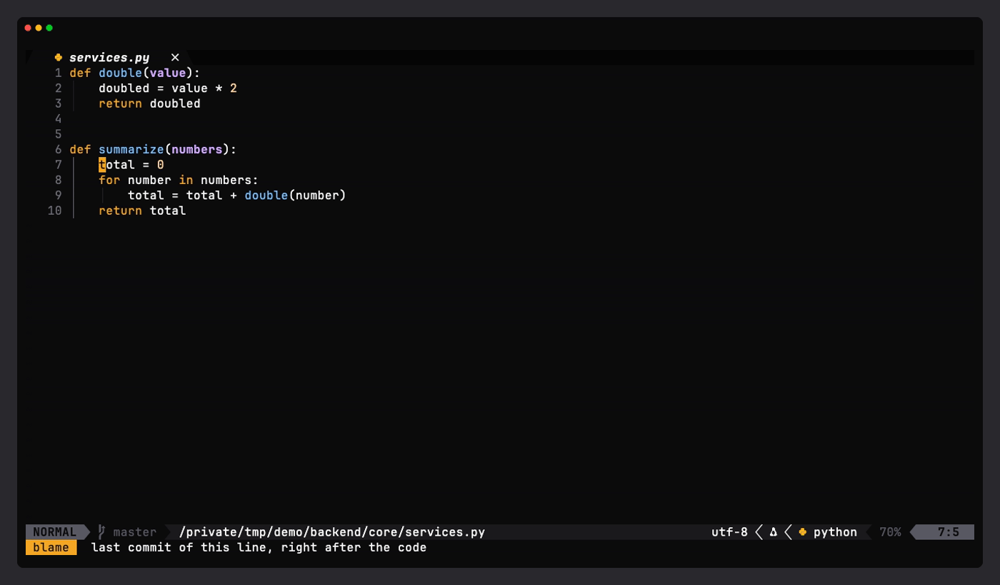

blame after the line · marks for added, changed and deleted lines · `<leader>gb` blame on/off

</td>
</tr>
</table>

## All keys

### Move

| Key | Does |
|---|---|
| `H` / `L` | line start / line end |
| `W` / `B` | word **back** / word **forward** (swapped on purpose) |
| `<leader>j` / `<leader>k` | down / up one screen line in a wrapped line |

### Files, windows, tabs

| Key | Does |
|---|---|
| `<leader>ww` / `<leader>wq` / `<leader>qq` | save / save and quit / quit without saving |
| `<leader>ee` / `<leader>ef` | explorer on/off / show the current file in it |
| `<leader>sv` / `<leader>sh` | split vertical / horizontal |
| `<leader>sm` / `<leader>se` | maximize split (again to restore) / equalize splits in every tab |
| `<leader>tn` / `<leader>tp` | next / previous tab |
| `<leader>to` / `<leader>td` | new empty tab / close tab |

### Search

| Key | Does |
|---|---|
| `<leader>ff` | find files, gitignored ones too |
| `<leader>fg` | grep the project as you type |
| `<leader>fb` / `<leader>fo` | open buffers / symbols of this file |

### Code

| Key | Does |
|---|---|
| `K` / `gd` / `gr` / `gi` | hover / definition / references / implementations |
| `<leader>gd` / `<leader>gr` | definition in a vertical split / references in telescope |
| `<leader>rn` / `<leader>ca` | rename / code action |
| `]d` / `[d` (or `<leader>gn` / `<leader>gp`) | next / previous problem, `3]d` jumps three |
| `<leader>gf` / `<leader>E` | show the problem / same, focused so you can copy it |
| `<leader>F` | format the file, or the selection in visual mode |
| `<leader>S` | replace the word (or selection) everywhere in the file |
| `af` `if` / `ac` `ic` | function / class text objects: `daf` deletes a function |
| `an` / `in` (visual) | grow / shrink the selection by syntax node |

### Tools

| Key | Does |
|---|---|
| `<leader>gb` | inline git blame on/off |
| `<leader>mp` / `<leader>mP` | markdown preview start / stop |
| `<leader>rr` | run the HTTP request under the cursor |
| `<leader>db` | database UI on/off |

<details>
<summary>Notes on some keys</summary>

- **Tabs** are the buffers bufferline draws on top. Tab pages use the native
  `gt` / `gT`. Not on `<Tab>`: in a terminal that is the same byte as `<C-i>`,
  and it would kill jumplist-forward.
- **`W` / `B`** are swapped in normal mode only; operators and visual mode keep
  the builtins.
- **`gd` `gr` `gi` `K` `<leader>rn` `<leader>ca`** are buffer-local: they appear
  once a language server attaches.
- **`<leader>gd`** splits only after a result comes back, so a miss leaves no
  empty window.
- **`<leader>F`** uses conform.nvim with no LSP fallback. If it seems to do
  nothing, run `:ConformInfo`.
- **`<leader>S`** fills `:%s/\<word\>/word/gI` with the old word as the
  replacement and the cursor after it: clear it with `<C-w>`, type the new
  text, press Enter.
- **`<leader>db`**: inside the database UI, `<leader>S` in a query buffer runs
  that query.
- **`<leader>dl`** re-expands `${file}`, so it debugs the buffer you are on,
  not the one the last run used.
- **`<leader>be`**: uncaught only (default), user unhandled, or raised. The
  choice is kept for the next sessions.
- Every map has a `desc`, so `:Telescope keymaps` lists them all.

</details>

## Debugging

Works in python, go, javascript, typescript and react. Any other filetype has
no configuration, and `<leader>dc` says so instead of starting.

| Breakpoints | | Session | |
|---|---|---|---|
| `<leader>bb` | toggle on this line | `<leader>dc` | start (config menu) / continue |
| `<leader>bc` | stop only when a condition holds | `<leader>dj` | step over |
| `<leader>bl` | logpoint: print, do not stop | `<leader>dk` / `<leader>do` | step into / step out |
| `<leader>ba` | list them all (quickfix) | `<leader>dl` | run the last config again |
| `<leader>br` | delete them all | `<leader>dt` / `<leader>dd` | terminate / disconnect |
| | | `<leader>du` | show / hide the UI |

Python only: `<leader>df` debugs the test under the cursor (`Class::method`
included), `<leader>dp` picks a test from the file, `<leader>be` picks when
exceptions stop the session.

**A full run** (the GIF at the top), on a file with a `double()` helper called
in a loop:

1. `<leader>bc` on the loop line, answer `i == 3`
2. `<leader>bl` on the first line of `double`, answer `double {value}`
3. `<leader>dc`, pick `1` (Launch file): it stops on the loop only when `i` is 3
4. read `i` and `total` in the Locals panel on the left
5. `<leader>dk` steps into `double`, `<leader>do` comes back, `<leader>dj` moves
   one line
6. `<leader>dc` runs to the end; the logpoint lines are in the REPL on the right
7. `<leader>dt` ends it, `<leader>dl` runs the same config again without asking

<details>
<summary>Inside the debug UI</summary>

Left column: scopes, watches, breakpoints. Right column: REPL and console. Both
scale with the terminal width, and the UI opens and closes with the session.

In any panel: `<CR>` expands, `e` edits a value, `d` removes an entry, `r`
sends the entry to the REPL, `o` opens, `t` toggles. The watches panel is a
prompt buffer: press `i` and type an expression such as `total * 10`. The REPL
takes expressions the same way.

Commands, once the plugin has loaded: `:DapEval` (evaluate expressions in a
scratch window), `:DapToggleRepl`, `:DapPause`, `:DapRestartFrame`,
`:DapShowLog`.

</details>

Every launch config per language, async python and the known quirks are in
[docs/DEVELOPMENT.md](docs/DEVELOPMENT.md#debugging-in-depth).

## Good to know

- **Theme**: Terminal Noir, the same palette as the iTerm2 profile.
- **Sessions**: the last session comes back on startup. `nvim .` always opens the
  file explorer next to it; a plain `nvim` opens it only when nothing was restored.
- **Startup**: about 50 ms, most plugins load on first use.
- **Under the hood**: folder layout, plugins, LSP and treesitter setup,
  formatters, tests and how the GIFs are recorded are in
  [docs/DEVELOPMENT.md](docs/DEVELOPMENT.md).
